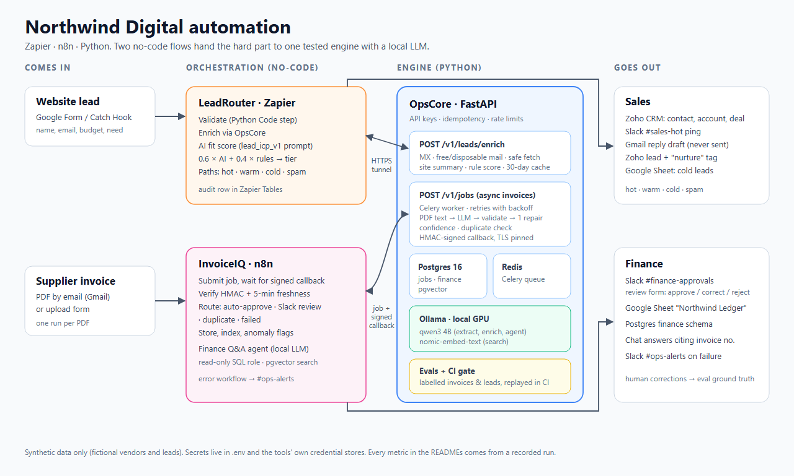

# Northwind Digital automation portfolio

Three connected projects for a fictional 20-person agency, Northwind Digital. Two no-code flows decide *what happens*, and a tested Python engine decides *what the data is*:

| Project | Tool | What it does | Status |
|---|---|---|---|
| [**OpsCore**](opscore/) | Python · FastAPI · Celery · Postgres/pgvector · Ollama | Lead enrichment, and invoice extraction with validation, repair, confidence, duplicate checks, async jobs with HMAC-signed callbacks, and an eval harness that gates CI | Done |
| [**InvoiceIQ**](invoiceiq/) | n8n | Supplier invoice by email or form, then OpsCore extraction, then Slack approval, then a Postgres and Google Sheets ledger, plus a local finance Q&A agent that cites invoice numbers | Done, accepted 2026-10-19 |
| [**LeadRouter**](leadrouter/) | Zapier | Website lead, then validation, OpsCore enrichment and AI fit score, then hot / warm / cold / spam routing to Zoho CRM, Slack, Gmail drafts and Sheets | Ran live on Zapier 19–27 Oct 2026 (Pro trial); 15 test leads end to end, plus 3 form leads ([results](leadrouter/test_run.md)) |



## The "lead to ledger" story

1. A prospect fills in the contact form.
2. **LeadRouter** checks the lead in a Python Code step and asks **OpsCore** to enrich it: MX, free or disposable mail, a safe homepage fetch, a site summary and a rule score.
3. An AI step scores the lead's fit, and code blends that with the rules score into a tier.
4. A hot lead becomes a Zoho deal, a Slack ping and a Gmail **draft**. It is never auto-sent.
5. The client signs, and suppliers start invoicing.
6. Their PDFs reach the AP inbox. **InvoiceIQ** gives each PDF its own n8n run and sends it to OpsCore as an async job. It accepts the result only with a valid HMAC signature less than 5 minutes old.
7. The invoice is then routed:
   - confident invoices are filed automatically;
   - uncertain ones go to a Slack review form (approve, correct or reject);
   - duplicates are skipped;
   - failures alert #ops-alerts.
8. Filed invoices land in Postgres, the "Northwind Ledger" Google Sheet and a pgvector index.
9. A finance agent on a local LLM answers questions such as "which invoices did a person approve?" and cites the invoice numbers.
10. Every human correction goes back to OpsCore as eval ground truth.

## Measured results

Every number links to the run that produced it. Nothing here was typed in from memory.

**OpsCore evals.** Scorecard: [`opscore/evals/report.md`](opscore/evals/report.md). Method: [D29](opscore/DECISIONS.md). Findings: [D30](opscore/DECISIONS.md). The model is the local qwen3 4B on a GTX 1660 SUPER, so the cost is $0 per document. Test slices ran 3 times, with identical scores.

| Invoices, production prompt v2 | Same templates, unseen (n=20) | New layout (n=8) |
|---|---|---|
| Field accuracy, 8 header fields | 93.1% | 98.4% |
| Documents fully exact | 15/20 | 5/8 |
| Line-item F1 | 0.945 | 0.842 |
| Wrong amount / quantity / invoice no. that still reached "done" | **0** | **0** |

- **Leads** (`lead_icp_v1` + LeadRouter scoring, n=14 dev / 16 test):
  - final tier correct: 11/14 and 10/16;
  - spam recall: 5/5;
  - the main gap: warm leads over-scored as hot.
- **LeadRouter on Zapier** (15 synthetic leads; [run log](leadrouter/test_run.md)):
  - On the first pass, 10 of 15 runs completed.
  - The 5 failures were 2 transient Zapier Code-step errors and 3 Zoho tag calls. The tag calls broke because the Zoho org had dropped to the Free Edition.
  - After a one-step fix (v2) and 2 replays, all 15 ended on their expected path: 14/14 scored leads in the expected tier, and the bad-email lead alerted #ops-alerts.
  - Three leads also came in through the Google Form and its feeder Zap:
    - FORM-2 was routed cold;
    - FORM-3 was routed hot, with the run starting about 2 min 40 s after Submit;
    - FORM-4 took the error path for real while OpsCore's tunnel was down.
  - LeadRouter ran only inside Zapier's Pro trial, which ended on 27 Oct 2026. On the Free plan its premium steps are off, so the Zap no longer runs. The screenshots, the video and the run log are the record.
- **Tests:** 163 OpsCore tests, 11 LeadRouter Code-step tests, and a CI eval gate that replays recorded model answers ([local proof](opscore/docs/evidence/p6_ci_local.txt)).

**InvoiceIQ acceptance run** (10 emailed test invoices; [details](invoiceiq/README.md#acceptance-run-p5-done-when)):
- 8 filed: 6 automatically and 2 after Slack review, one of them with a corrected total.
- 1 duplicate skipped.
- 1 image-only scan failed and alerted #ops-alerts.
- The agent's answers to 5 test questions: 4 of 5 fully correct on the first prompt, and 5/5 after one prompt fix. Every answer cited invoice numbers.
- The run also exposed a Google Sheets append race, which is now fixed and proven with 8 parallel writes. The write-up is in the InvoiceIQ README.

## Demo videos

Each video is about a minute long, with no voice-over yet. Each was privacy-checked before use ([log](opscore/docs/evidence/privacy_check.txt)), and the shot lists are in [`docs/video_scripts.md`](docs/video_scripts.md).
- [LeadRouter](videos/Recording_Northwind2_trimmed.mp4) (46 s): a form lead scored, routed hot and alerted.
- [InvoiceIQ](videos/Recording_Northwind3_trimmed.mp4) (62 s): the n8n flows, the Slack correction, the ledger and the local Q&A agent.
- [OpsCore](videos/Recording_Northwind4_trimmed.mp4) (59 s): the API, the test suite, the eval report and the CI gate.

## Repository

```
opscore/     FastAPI engine, Celery worker, evals (run_evals, cassettes, report), DECISIONS.md
invoiceiq/   n8n workflow exports, finance SQL, test invoices, export script
leadrouter/  Zap documentation, Python Code steps + tests, 15 test leads, Catch Hook sender
docs/        architecture diagram, screenshots, 60-second video scripts
videos/      the three trimmed demo videos (raw takes stay local and git-ignored)
.github/     CI: pytest + LeadRouter tests + eval gate
```

- **Data:** all of it is synthetic. Every vendor, lead and invoice is fictional. The real company domains in LeadRouter's test leads are used only so OpsCore has a homepage and an MX record to check. Nothing is ever emailed to them.
- **Secrets:** they live only in each tool's credential store and in git-ignored `.env` files. Committed files contain no secrets: the workflow exports reference credentials by name only.
